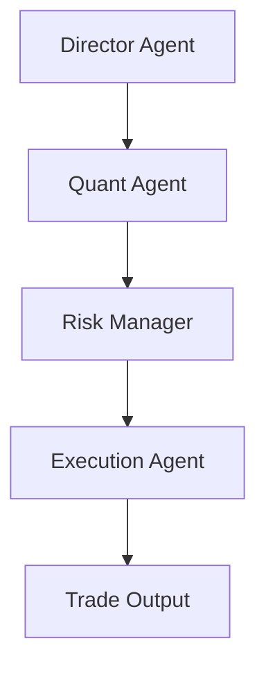

# AutoHedge

[](https://discord.gg/VapjxpSyHC3) [](https://www.youtube.com/@kyegomez3242) [](https://www.linkedin.com/in/kye-g-38759a207/) [](https://x.com/swarms_corp)


AutoHedge is an enterprise-grade autonomous agent hedge fund that trades on your behalf. It combines swarm intelligence and specialized AI agents to perform end-to-end market analysis, risk management, and execution with minimal human intervention.

**Current support:** Full autonomous trading on Solana. **Coming soon:** Coinbase and additional exchanges.

---

## Overview

AutoHedge is built to be the world's most powerful autonomous agent hedge fund. It runs continuous analysis, generates and validates trading theses, sizes risk, and executes orders across supported venues. The system is designed for institutional reliability: structured outputs, comprehensive logging, and a risk-first architecture that scales from single strategies to multi-venue, multi-asset deployment.

---

## Features

- **Multi-Agent Architecture**: Specialized agents for each stage of the trading pipeline
  - Director Agent: strategy and thesis generation
  - Quant Agent: technical and statistical analysis
  - Risk Management Agent: position sizing and risk assessment
  - Execution Agent: order generation and execution

- **Real-Time Market Analysis**: Integration with live market data for analysis and execution
- **Risk-First Design**: Built-in risk management and position sizing before any execution
- **Structured Output**: JSON-formatted recommendations and analysis for downstream systems
- **Enterprise Logging**: Detailed, configurable logging for audit and debugging
- **Extensible Framework**: Modular design for custom strategies and new venues

---

## Supported Venues

| Venue      | Status        | Notes                    |
|-----------|----------------|--------------------------|
| Solana    | Supported      | Full autonomous trading  |
| Coinbase  | Coming soon    | In development           |
| Other CEX | Roadmap        | Planned expansion        |

---

## Quick Start

### Installation

```bash
pip install -U autohedge
```

### Environment Variables

```bash
# Jupiter API (token price & search tools)
# Get a key at https://portal.jup.ag
JUPITER_API_KEY=

# OpenAI (experimental agents)
OPENAI_API_KEY=
ANTHROPIC_API_KEY=
WORKSPACE_DIR="agent_workspace"

# Trading
WALLET_PRIVATE_KEY=""
```

See `.env.example` for a full reference.

### Basic Usage

```python
autohedge 
```

### Optional Codex research backend

Use a local [Codex CLI](https://developers.openai.com/codex/cli) login
for research on data you supply, including an eligible ChatGPT account.
Install the CLI, then authenticate using its own login flow:

```bash
npm install -g @openai/codex
codex login
autohedge --llm-backend codex
```

This mode runs six sequential requests: director thesis, sentiment,
quantitative analysis, risk assessment, order proposal, and director synthesis.
Each stage receives the original task and the preceding reports. Results use
the existing `AutoHedge` conversation output formats and label orders as
proposals. Each new task starts a fresh research context.

**Research only:** provide the data, timestamps, and sources in your task.
Codex mode does not call Exa, fetch live market data, dispatch Swarms handoffs,
or execute trades. It uses a fixed Python pipeline for the five roles. The
default `litellm` backend retains the existing workers and handoffs.

```python
from autohedge import AutoHedge

system = AutoHedge(
    llm_backend="codex",
    codex_config={"model": None, "timeout": 180},
    output_type="str",
)
report = system.run(
    "Research this fictional dataset only: SYNTH closes [100, 101, 99, 102], "
    "daily volume [1000, 1200, 900, 1100]. Explain data gaps. "
    "No news or fundamentals are provided. Do not recommend a live trade."
)
print(report)
```

| Setting | Python | CLI | Environment |
| --- | --- | --- | --- |
| Backend | `llm_backend="codex"` | `--llm-backend codex` | `AUTOHEDGE_LLM_BACKEND=codex` |
| Model | `codex_config={"model": "MODEL"}` | `--codex-model MODEL` | `AUTOHEDGE_CODEX_MODEL=MODEL` |
| Timeout per stage | `codex_config={"timeout": 180}` | `--codex-timeout 180` | `AUTOHEDGE_CODEX_TIMEOUT=180` |

Explicit Python or CLI values override `.env`/environment values. The defaults
are `litellm`, the CLI's default model, and 180 seconds per stage. In Python,
an explicit `"model": None` also overrides a model set in the environment.
Choose a model supported by your Codex account; the default workers' API model
names are not automatically forwarded to Codex.

The integration invokes official [`codex exec`](https://developers.openai.com/codex/noninteractive)
with a temporary working directory, read-only sandbox, disabled agent tools
and web search, and ephemeral sessions. It ignores user CLI configuration for
these isolated requests while reusing CLI-managed authentication. AutoHedge
does not read or copy login tokens. Existing Codex usage limits apply; this
does not provide unlimited API access. Missing login, model access, CLI version
errors, and timeouts stop the run without falling back to an API provider.
On failure, check `codex login status` and update the CLI. The flags were
validated with Codex CLI 0.147.0.

An [example notebook](examples/codex_research.ipynb) includes an offline preview
and an optional live run. Offline tests require no CLI login or API keys:

```bash
pip install -e . pytest
SWARMS_TELEMETRY_ON=false python -m pytest tests/test_codex_backend.py -q
```

---

## Architecture

AutoHedge uses a multi-agent pipeline where each agent has a defined responsibility:



---

## Contributing

Contributions are welcome. See [Contributing Guidelines](CONTRIBUTING.md) for details.

1. Fork the repository
2. Create a feature branch (`git checkout -b feature/AmazingFeature`)
3. Commit changes (`git commit -m 'Add some AmazingFeature'`)
4. Push to the branch (`git push origin feature/AmazingFeature`)
5. Open a Pull Request

---

## License

MIT License. See [LICENSE](LICENSE) for details.

---

## Acknowledgments

- [Swarms](https://swarms.ai) for the AI agent framework

---

## Support

- Issue Tracker: [GitHub Issues](https://github.com/The-Swarm-Corporation/AutoHedge/issues)
- Community: [Discord](https://swarms.ai)

---

AutoHedge by [The Swarm Corporation](https://github.com/The-Swarm-Corporation)
